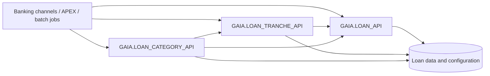

# GNI Software — Loan Packages Documentation

**Oracle PL/SQL · Banking loan services · Technical reference**

A centralized documentation workspace for three related loan-service packages. The goal is to make their **public interfaces, business behavior, data relationships, integrations, and processing workflows** easy to understand without reading thousands of lines of PL/SQL for every question.

> **Documentation scope:** Source-based technical reference, not a substitute for deployed schema metadata, integration testing, or production operational procedures.

---

## Explore the packages

| Package | Primary responsibility | Start here |
|---|---|---|
| **`GAIA.LOAN_API`** | Shared loan operations: accounts, payments, schedules, interest, overdue handling, limits, accounting, and history. | [Overview](docs/loan-api.md) |
| **`GAIA.LOAN_TRANCHE_API`** | Tranche lifecycle, installment plans, allocation, overdue/transit processing, interest, history, and reversals. | [Overview](docs/loan-tranche-api.md) |
| **`GAIA.LOAN_CATEGORY_API`** | Loan category changes, charge-off and closing flows, court decisions, payment collection, and legacy IBS reconciliation. | [Overview](docs/loan-category-api.md) |

### Quick access

| Documentation | LOAN_API | LOAN_TRANCHE_API | LOAN_CATEGORY_API |
|---|---|---|---|
| **API Reference** | [Open](docs/api.md) | [Open](docs/loan-tranche-api-reference.md) | [Open](docs/loan-category-api-reference.md) |
| **Workflows** | [Open](docs/workflows.md) | [Open](docs/loan-tranche-workflows.md) | [Open](docs/loan-category-workflows.md) |
| **Data Model** | [Open](docs/data-model.md) | [Open](docs/loan-tranche-data-model.md) | [Open](docs/loan-category-data-model.md) |
| **Dependencies** | [Open](docs/dependencies.md) | [Open](docs/loan-tranche-dependencies.md) | [Open](docs/loan-category-dependencies.md) |
| **Error Handling** | [Open](docs/error-handling.md) | [Open](docs/loan-tranche-error-handling.md) | [Open](docs/loan-category-error-handling.md) |

## How the packages fit together

*Conceptual map of source-observed integrations; arrows do not describe every runtime call or database constraint.*

## How to use this documentation

1. **New to a package?** Open its **Overview** for scope and functional areas.
2. **Investigating a procedure or function?** Use **API Reference** for signature, parameters, and business-level execution logic.
3. **Tracing data?** Open **Data Model** to identify principal objects and logical joins.
4. **Reviewing integrations?** Consult **Dependencies** for shared services and configured operations.
5. **Understanding execution or failures?** See **Workflows** and **Error Handling**.

## Documentation standards

- **Public API first:** Document the published package specification; distinguish public methods from private helpers.
- **Business meaning over code dumps:** Explain SQL selection rules, calculations, validations and data effects where supported by the package body.
- **Navigable by design:** Method indexes, functional groups and links back to the overview keep large references usable.
- **Explicit review boundaries:** Logical joins are not asserted foreign keys; indirect posting, environment configuration and transaction behavior require separate verification.

## Site navigation

The [documentation landing page](docs/index.md) mirrors this package directory. The documentation site's navigation is defined in [`mkdocs.yml`](mkdocs.yml).

---

*GNI Software · Loan module documentation · Maintained as a source-backed documentation project*
