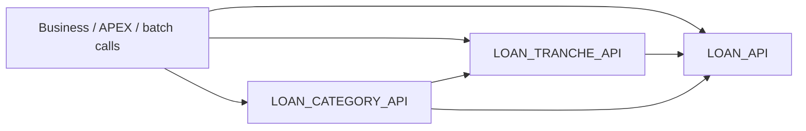

# GNI Software — Loan Packages

**Oracle PL/SQL · Banking loan services · Technical reference**

A single entry point for understanding the public APIs and business processes of GNI's shared loan packages. Start with a package overview, then follow its API Reference, workflow diagrams, data relationships, dependencies and validations.

> The documentation describes source-observed behavior. Physical schema constraints and deployed runtime behavior require environment-specific verification.

## Package directory

| Package | What it covers | Get started |
|---|---|---|
| **`GAIA.LOAN_API`** | Shared loan lifecycle, payment and interest logic, accounts, schedules, limits, accounting and audit | [Overview](loan-api.md) · [API](api.md) |
| **`GAIA.LOAN_TRANCHE_API`** | Tranche creation and merging, allocations, schedules, overdue transitions, interest and reversal | [Overview](loan-tranche-api.md) · [API](loan-tranche-api-reference.md) |
| **`GAIA.LOAN_CATEGORY_API`** | Category assignment, charge-off, legal decisions, closures, payment collection and legacy IBS checks | [Overview](loan-category-api.md) · [API](loan-category-api-reference.md) |

## Find what you need

| Documentation area | LOAN_API | LOAN_TRANCHE_API | LOAN_CATEGORY_API |
|---|---|---|---|
| **Workflows** | [Open](workflows.md) | [Open](loan-tranche-workflows.md) | [Open](loan-category-workflows.md) |
| **Data Model** | [Open](data-model.md) | [Open](loan-tranche-data-model.md) | [Open](loan-category-data-model.md) |
| **Dependencies** | [Open](dependencies.md) | [Open](loan-tranche-dependencies.md) | [Open](loan-category-dependencies.md) |
| **Error Handling** | [Open](error-handling.md) | [Open](loan-tranche-error-handling.md) | [Open](loan-category-error-handling.md) |

## Package relationship overview

*Simplified source-level integration map, not a complete call graph.*

## Reading guide

**Overview** sets the functional scope. **API Reference** gives public signatures and implementation-driven descriptions. **Workflows** trace main execution paths; **Data Model** identifies significant tables and logical joins; **Dependencies** describes shared services; and **Error Handling** documents source-observed validation and failure conditions.

Public and private routines are distinguished, and unverified database relationships are not presented as physical constraints.

---

*GNI Software · Loan Packages Documentation*
