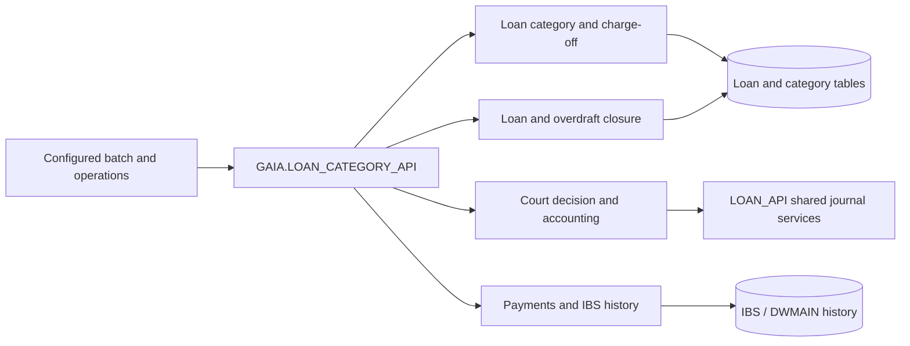

# LOAN_CATEGORY_API — Overview

[← All packages](index.md) · [API Reference](loan-category-api-reference.md) · [Workflows](loan-category-workflows.md) · [Data Model](loan-category-data-model.md) · [Dependencies](loan-category-dependencies.md) · [Error Handling](loan-category-error-handling.md)

`GAIA.LOAN_CATEGORY_API` coordinates category-related loan processing, court-decision debt adjustments, charge-off classification, automatic loan closure and payment collection. The package also reads legacy IBS transaction history when evaluating payments and legal decisions.

| Attribute | Value |
|---|---|
| Package | `GAIA.LOAN_CATEGORY_API` |
| Source | Supplied package specification and body |
| Public methods | **14: 11 procedures, 3 functions** |
| Implementation | Approximately 9,840 lines, including internal routines |
| Documentation status | Initial source-backed structure; detailed method review in progress |

## Documentation

| Page | Scope |
|---|---|
| [API Reference](loan-category-api-reference.md) | All public routines, grouped by business responsibility |
| [Workflows](loan-category-workflows.md) | Primary category, court-decision and closure processing paths |
| [Data Model](loan-category-data-model.md) | Principal source-visible objects and logical relationships |
| [Dependencies](loan-category-dependencies.md) | Banking packages, transaction services and IBS data integration |
| [Error Handling](loan-category-error-handling.md) | Key validation and processing outcomes |

## Functional areas

| Area | Business responsibility | Public methods | API group |
|---|---|---:|---|
| **Category orchestration and classification** | Runs configured category jobs and maintains loan category states | 3 | [View](loan-category-api-reference.md#domain-category-orchestration-and-classification) |
| **Court decisions and accounting** | Applies court decisions and constructs related accounting entries | 3 | [View](loan-category-api-reference.md#domain-court-decisions-and-accounting) |
| **Charge-off and loan closure** | Executes configured loan closure flows | 2 | [View](loan-category-api-reference.md#domain-charge-off-and-loan-closure) |
| **Payment collection and legacy IBS** | Collects payments and checks historical IBS payment information | 4 | [View](loan-category-api-reference.md#domain-payment-collection-and-legacy-ibs) |
| **Overdraft and portfolio lookup** | Checks guarantee loan type and requests overdraft closure | 2 | [View](loan-category-api-reference.md#domain-overdraft-and-portfolio-lookup) |

**Classification note:** these are documentation domains rather than physically separate PL/SQL modules.

## Business architecture

## Initial source-review notes

- `run_loan_category` reads configured procedure names from `SP_LOAN_SUB_CATEGORY_PR` and invokes them using dynamic PL/SQL. The configuration is part of the operational workflow.
- `apply_court_decision` filters pending entries in `LOAN_COURT_DECISION_LIST`, compares court-decision amounts with loan balances and adjusts for payments found in IBS and loan history. This long procedure needs a dedicated step-by-step Description.
- `set_charge_off_status` and automatic closure flows use configurable query/parameter tables rather than one fixed hard-coded loan filter.
- `set_category_close_date` is a body-private procedure, **not** a public declaration.
- The source exposes `LOAN_API.G_ENTRIES_LIST_TAB` in a public output parameter: callers share a cross-package collection type.

For detailed conditions and data updates, refer to the evolving [API Reference](loan-category-api-reference.md).
