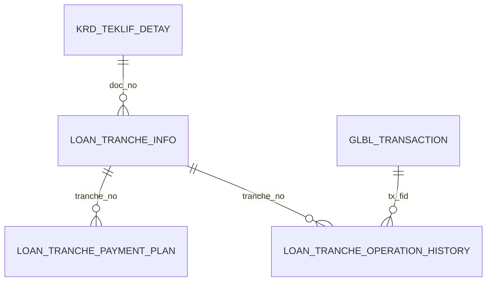

# LOAN_TRANCHE_API — Data Model

[← Overview](loan-tranche-api.md)

| Object | Purpose in the implementation |
|---|---|
| `KRD_TEKLIF_DETAY` | Loan master, status, contract, maturity, tranche-enabled flag and interest configuration |
| `KRD_ODEME_PLAN` | Base loan repayment schedule |
| `LOAN_TRANCHE_INFO` | Tranche identifiers, status, dates, balances grouped as MAIN/INT/OVD/TRS/PEN |
| `LOAN_TRANCHE_PAYMENT_PLAN` | Tranche due dates, account type, scheduled/paid amount, overdue/transit dates, closure |
| `LOAN_TRANCHE_OPERATION_HISTORY` | Operation and transaction amount deltas per tranche |
| `LOAN_TRANCHE_INFO_LOG` | Master snapshots to support restoration |
| `LOAN_TRANCHE_PAYMENT_PLAN_LOG` | Payment plan snapshots to support restoration |
| `LOAN_TRANCHE_OVERDUE_TRANSIT_QUEUE` | Working list of classified due / overdue movements |
| `LOAN_ACC_TYPES_PR` | Account groups, payable flag, scheduled or unscheduled balance eligibility |
| `LOAN_TRANCHE_TYPES` | Tranche payment ordering |
| `LOAN_TRANCHE_PERIODS` | Configurable date period rules |
| `LOAN_TRANCHE_PARAMETERS` | Tranche configuration and validation |
| `LOAN_SCHEDULE_TYPES`, `PKRD_ODETIP_PR` | Schedule conversion lookup |
| `PKRD_TURKOD_PR` | Product thresholds and grace settings |
| `CS_ACCOUNT` | Physical loan accounts, balances and posting information |
| `ODEME_PLAN_TMP` | Intermediate generated schedule rows |
| `GLBL_TRANSACTION` | Transaction identifier mapping |

## Key logical joins

These are observed logical associations, **not** verified foreign-key declarations. `doc_no` generally selects a loan, `tranche_no` identifies a tranche, and `tx_fid` ties log/history operations to a transaction. Tranche creation updates master/plan rows; interest and overdue operations update balances and history; recovery reads `_LOG` state and historical movements.